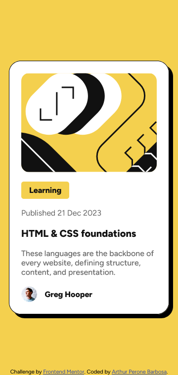
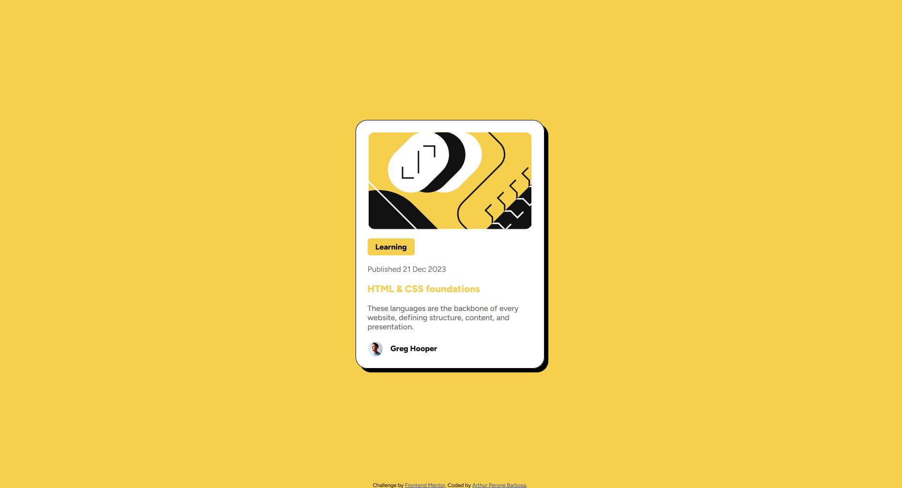

# Frontend Mentor - Blog preview card solution

This is a solution to the [Blog preview card challenge on Frontend Mentor](https://www.frontendmentor.io/challenges/blog-preview-card-ckPaj01IcS). Frontend Mentor challenges help you improve your coding skills by building realistic projects. 

## Table of contents

- [Frontend Mentor - Blog preview card solution](#frontend-mentor---blog-preview-card-solution)
  - [Table of contents](#table-of-contents)
  - [Overview](#overview)
    - [The challenge](#the-challenge)
    - [Screenshot](#screenshot)
      - [Desktop](#desktop)
      - [Mobile](#mobile)
      - [Action](#action)
    - [Links](#links)
  - [My process](#my-process)
    - [Built with](#built-with)
    - [What I learned](#what-i-learned)
  - [Author](#author)

## Overview

### The challenge

Users should be able to:

- See hover and focus states for all interactive elements on the page

### Screenshot
#### Desktop

#### Mobile

#### Action

### Links

- Solution URL: 
- Live Site URL: [Live site](https://arthurperone.github.io/blog-preview-card/)

## My process

### Built with

- Semantic HTML5 markup
- CSS custom properties
- Flexbox
- Custom font-face

### What I learned

This project introduced me to a few features I hadn’t known existed, an example is the `<time>` tag.
I also struggled quite a bit with setting up the illustrative image; instead of being resized, it kept getting cropped on the sides. I spent a lot of time on this customization, trying to do it on my own, without searching in web, and I succeeded.

## Author

- Github - [Arthur Perone](https://github.com/ArthurPerone/)
- Frontend Mentor - [@ArthurPerone](https://www.frontendmentor.io/profile/ArthurPerone)
